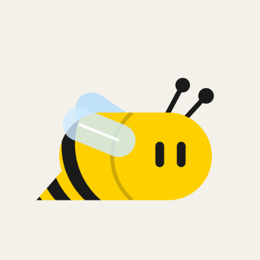

  

<h1 align="center">CafebeeAI</h1>

<em>0xCAFEBEEA. Agentic AI for Mobile.</em>

A React Native app that puts a tool-using LLM agent directly on your phone: every Project is a real working directory, and the model can read, write, search, download into it — with you approving each mutation.

<em>I use this bee to generate business trip receipts.</em>

## Functions

- **Manage Projects** — each project is a sandboxed folder (files + chat history + config), import/export as zip
- **OpenAI Compatible** — bring any endpoint and API key; streaming chat with tool calls, reasoning content, multi-step agent loop
- **Agentic file tools** — `read_file` / `write_file` / `edit_file` / `list_files` / `search_files` / `download_file` / `show_form`, all scope-locked to the project with inline approve/reject cards
- **Quick HTML PoC via static server** — serve the current project over HTTP (Lighttpd) and open the model's generated pages in your phone browser
- **Multi-session parallelism** — run several agent conversations at once across projects
- **Newsprint / light / dark themes**, adjustable font scale, GFM markdown with tables and code blocks

## Disclaimer

This app is provided "as is", without warranty of any kind. It only relays your prompts to the OpenAI Compatible endpoints you configure; the responses are generated by third-party large language models and may be inaccurate, incomplete, or outdated. Do not rely on generated output for professional, legal, medical, or financial decisions without independent verification. You are responsible for reviewing and approving every file the agent proposes to write into your projects, and for complying with the terms of the providers and models you connect to. Keep your own backups of project data; the authors accept no liability for data loss or damages arising from use of this software.

## License

Released under the [MIT License](LICENSE).

Copyright (c) 2026 The CafebeeAI authors
